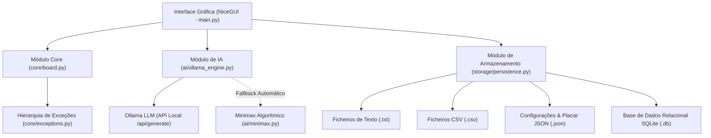
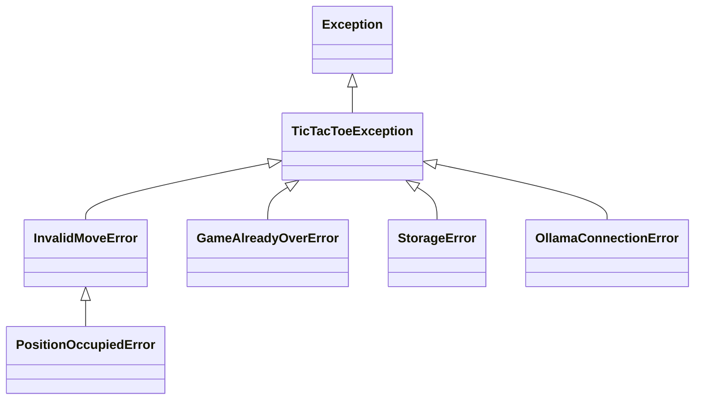

# 📘 Documentação Técnica: Tic-Tac-Toe AI (Jogo do Galo)

## 1. Visão Geral e Arquitetura do Sistema
O **Tic-Tac-Toe AI** é uma aplicação completa de Jogo do Galo desenvolvida em **Python** que combina programação modular, persistência poliglota (multi-formato), inteligência artificial generativa com **Ollama** (LLM local) e fallback algorítmico com **Minimax**, com uma interface gráfica moderna e reativa construída em **NiceGUI**.

### 1.1 Diagrama de Arquitetura



---

## 2. Estrutura Modular do Projeto

```
nicegui_demo/
├── main.py                     # Ponto de entrada, interface gráfica e gestão de eventos
├── requirements.txt            # Dependências do projeto
├── core/                       # Módulo 1: Regras do jogo, lógica e exceções
│   ├── __init__.py
│   ├── board.py                # Estado do tabuleiro 3x3 e validações
│   └── exceptions.py           # Exceções personalizadas
├── ai/                         # Módulo 2: Motores de Inteligência Artificial
│   ├── __init__.py
│   ├── ollama_engine.py        # Cliente de comunicação com LLM e parsing de JSON
│   └── minimax.py              # Algoritmo Minimax com níveis de dificuldade
├── storage/                    # Módulo 3: Persistência Multi-formato e Base de Dados
│   ├── __init__.py
│   └── persistence.py          # Gestor de ficheiros TXT, CSV, JSON e SQLite
├── tests/                      # Testes Automatizados (unittest)
│   ├── test_board.py           # Validações de tabuleiro, jogadas e vitória
│   └── test_persistence.py     # Validações de escrita e leitura de ficheiros
├── data/                       # Armazenamento físico de dados
│   ├── logs/game_history.txt   # Registo narrativo textual
│   ├── metrics/matches.csv     # Tabela de métricas tabulares
│   ├── config/settings.json    # Preferências do utilizador
│   ├── config/leaderboard.json # Estatísticas acumuladas
│   └── db/tictactoe.db         # Base de dados relacional SQLite
└── docs/                       # Documentação do projeto
    ├── DOCUMENTACAO_TECNICA.md # Este documento
    └── MANUAL_UTILIZADOR.md    # Guia para utilizadores finais
```

---

## 3. Estruturas de Dados Utilizadas

1. **Matriz 3x3 (`List[List[str]]`)**:
   - Representação espacial do tabuleiro (`board.grid`), permitindo acesso direto em $O(1)$ às posições `grid[row][col]`.
2. **Tuplos (`Tuple[int, int]`)**:
   - Representação imutável das coordenadas `(row, col)` das jogadas.
3. **Listas de Dicionários (`List[Dict[str, Any]]`)**:
   - Registo histórico das jogadas e partidas (`moves_history`), serializável para JSON e exportável para CSV.
4. **Conjuntos e Compreensões de Listas**:
   - Utilizados no método `get_available_moves()` para filtrar dinamicamente as casas livres.

---

## 4. Validação de Dados e Tratamento de Exceções

### 4.1 Validação de Dados
- **Coordenadas**: `Board.validate_coordinates(row, col)` verifica estritamente se $0 \le \text{row}, \text{col} \le 2$.
- **Células Ocupadas**: `Board.is_cell_empty(row, col)` impede a sobrescrita de símbolos.
- **Higienização de Entradas**: `Board.validate_player_name(name)` limpa espaços em branco e garante limites seguros de caracteres.
- **Respostas do LLM**: O método `OllamaAIEngine.get_move_and_comment()` valida se as coordenadas devolvidas pelo modelo estão na lista de jogadas válidas atuais.

### 4.2 Hierarquia de Exceções (`core/exceptions.py`)


- `InvalidMoveError`: Lançada quando coordenadas violam os limites.
- `PositionOccupiedError`: Lançada ao tentar jogar numa célula já preenchida.
- `GameAlreadyOverError`: Impede jogadas após a conclusão da partida.
- `StorageError`: Trata falhas de I/O em disco ou ficheiros corrompidos.
- `OllamaConnectionError`: Trata timeouts ou ausência do serviço Ollama sem interromper o jogo.

---

## 5. Estratégia de Inteligência Artificial Híbrida

1. **Ollama LLM**:
   - Comunica via HTTP com a API local (`/api/generate`).
   - Fornece ao modelo o tabuleiro em ASCII e a lista de casas livres.
   - Força a geração em formato JSON estrito: `{"row": int, "col": int, "comment": str}`.
   - Suporta personalidades distintas: *Sarcástico*, *Amigável* e *Científico*.
2. **Minimax Fallback**:
   - Se o Ollama estiver desligado ou devolver formato inesperado, o sistema executa automaticamente a subrotina heurística Minimax.
   - Dificuldades suportadas: *Fácil* (aleatório), *Médio* (heurístico misto), *Imbatível* (árvore Minimax completa).

---

## 6. Persistência Poliglota

| Formato | Ficheiro | Finalidade |
|---|---|---|
| **TXT** | `data/logs/game_history.txt` | Registo narrativo legível por humanos das partidas. |
| **CSV** | `data/metrics/matches.csv` | Tabela cronológica para análise de dados e métricas. |
| **JSON** | `data/config/settings.json` | Configurações de utilizador e preferências de tema. |
| **JSON** | `data/config/leaderboard.json` | Placar agregado (vitórias, derrotas, empates). |
| **SQLite** | `data/db/tictactoe.db` | Armazenamento relacional avançado das partidas (Valorização). |

---

## 7. Testes Automatizados

O projeto inclui uma suite de testes unitários baseada no módulo `unittest` do Python:
- **`tests/test_board.py`**: Testa estados iniciais, jogadas válidas, limites do tabuleiro, exceções de sobreposição e condições de vitória (linhas, colunas, diagonais, empates).
- **`tests/test_persistence.py`**: Testa a criação, leitura e integridade dos ficheiros TXT, CSV, JSON e SQLite.

Execução dos testes:
```powershell
python -m unittest discover -s tests
```
