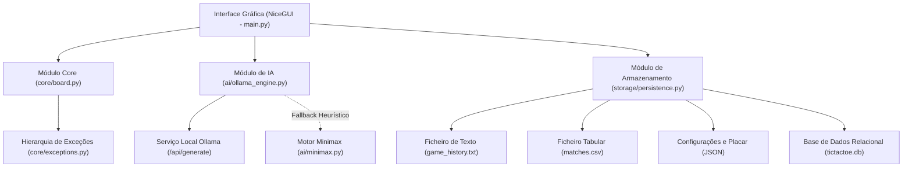
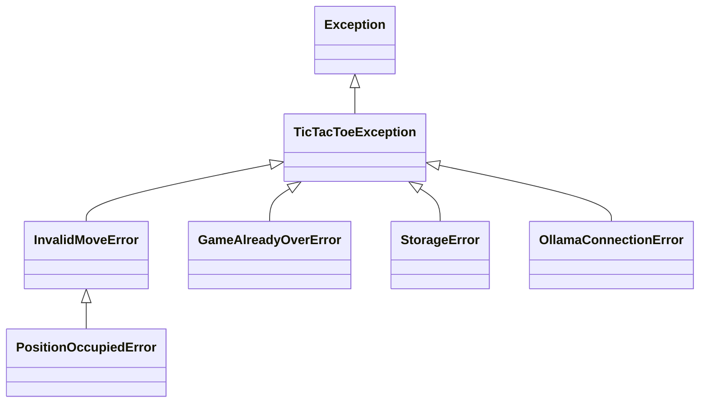

# Documentação Técnica: Tic-Tac-Toe AI

## 1. Visão Geral e Arquitetura do Sistema
O sistema consiste numa aplicação cliente-servidor leve construída em Python utilizando o framework NiceGUI. A arquitetura divide-se em camadas independentes para desacoplar a lógica de negócio (tabuleiro e regras), os motores de decisão (IA Ollama e Minimax), a persistência multi-formato (TXT, CSV, JSON e SQLite) e a camada de apresentação visual.

### 1.1 Diagrama de Componentes



---

## 2. Estrutura Modular

```
nicegui_demo/
├── main.py                     # Camada de apresentação e interface com o utilizador
├── requirements.txt            # Declaração explícita de dependências
├── core/                       # Lógica de negócio e validações
│   ├── __init__.py
│   ├── board.py                # Representação do tabuleiro e regras
│   └── exceptions.py           # Hierarquia de exceções de domínio
├── ai/                         # Motores de inteligência artificial
│   ├── __init__.py
│   ├── ollama_engine.py        # Integração HTTP com a API Ollama
│   └── minimax.py              # Algoritmo determinístico Minimax
├── storage/                    # Persistência de dados
│   ├── __init__.py
│   └── persistence.py          # Gestão de ficheiros TXT, CSV, JSON e SQLite
├── tests/                      # Verificação e testes de software
│   ├── test_board.py           # Testes unitários do tabuleiro
│   └── test_persistence.py     # Testes unitários dos ficheiros
├── data/                       # Armazenamento físico de dados
│   ├── logs/game_history.txt
│   ├── metrics/matches.csv
│   ├── config/settings.json
│   ├── config/leaderboard.json
│   └── db/tictactoe.db
└── docs/                       # Documentação do projeto
    ├── DOCUMENTACAO_TECNICA.md
    └── MANUAL_UTILIZADOR.md
```

---

## 3. Estruturas de Dados Utilizadas

1. **Matriz 3x3 (`List[List[str]]`)**:
   Representação espacial do tabuleiro (`grid`), permitindo acesso direto em O(1) através de índices `(row, col)`.
2. **Tuplos Imutáveis (`Tuple[int, int]`)**:
   Utilizados para armazenar e transacionar coordenadas de jogadas sem risco de mutação acidental.
3. **Dicionários Estruturados (`Dict[str, Any]`)**:
   Utilizados para carregar configurações, formatar payloads da API Ollama e representar partidas para persistência.
4. **Listas de Registos**:
   Armazenamento cronológico do histórico de lances (`moves_history`).

---

## 4. Validação de Dados e Tratamento de Exceções

### 4.1 Validações Implementadas
- **Limites de Coordenadas**: `Board.validate_coordinates` valida se `0 <= row, col <= 2`.
- **Integridade da Célula**: `Board.is_cell_empty` impede a sobreposição de peças em casas preenchidas.
- **Higienização de Inputs**: `Board.validate_player_name` normaliza espaços e delimita comprimento entre 2 e 25 caracteres.
- **Validação de Payload de IA**: Verificação rigorosa do formato JSON retornado pelo Ollama e validação se as coordenadas sugeridas pertencem às opções válidas do momento.

### 4.2 Hierarquia de Exceções (`core/exceptions.py`)



- `TicTacToeException`: Classe base herdada de `Exception`.
- `InvalidMoveError`: Coordenadas fora dos limites.
- `PositionOccupiedError`: Célula selecionada já preenchida.
- `GameAlreadyOverError`: Tentativa de efetuar jogada após término de partida.
- `StorageError`: Falhas de permissão, formato ou I/O no disco.
- `OllamaConnectionError`: Interrupção ou indisponibilidade na comunicação de rede com o modelo.

---

## 5. Motores de Inteligência Artificial

### 5.1 Ollama (LLM Local)
- Comunicação via pedido HTTP POST para `http://localhost:11434/api/generate`.
- O prompt injeta a representação em texto do tabuleiro e a lista explícita de casas disponíveis.
- Força resposta em JSON estrito (`format="json"`) contendo `{"row": int, "col": int, "comment": str}`.

### 5.2 Minimax (Algoritmo Determinístico)
- Função recursiva que avalia o valor terminal do tabuleiro (+10 para vitória da IA, -10 para derrota, 0 para empate).
- Dificuldades:
  - **Fácil**: Seleção aleatória entre as posições válidas.
  - **Médio**: Heurística probabilística mista (40% aleatório, 60% ótimo).
  - **Imbatível**: Avaliação ótima em profundidade total.

---

## 6. Persistência de Dados

1. **Ficheiro de Texto Simples (.txt)**:
   - Caminho: `data/logs/game_history.txt`
   - Registo em formato cronológico e legível das partidas concluídas.
2. **Ficheiro CSV (.csv)**:
   - Caminho: `data/metrics/matches.csv`
   - Estrutura colunar com cabeçalhos: `match_id, timestamp, player_name, winner, total_moves, difficulty, ai_engine, duration_seconds`.
3. **Ficheiros JSON (.json)**:
   - `data/config/settings.json`: Armazena definições de personalização, host e tema.
   - `data/config/leaderboard.json`: Agregação numérica de vitórias, derrotas e empates.
4. **Base de Dados Relacional SQLite (.db)**:
   - Caminho: `data/db/tictactoe.db`
   - Tabela `matches` criada com DDL standard para suporte a consultas SQL relacionais.

---

## 7. Testes Unitários

Suite de testes baseada no módulo `unittest`:
- `tests/test_board.py`: Cobertura de regras de negócio, limites e condições de término.
- `tests/test_persistence.py`: Verificação de escrita e leitura de TXT, CSV, JSON e SQLite.

Execução:
```powershell
python -m unittest discover -s tests
```
